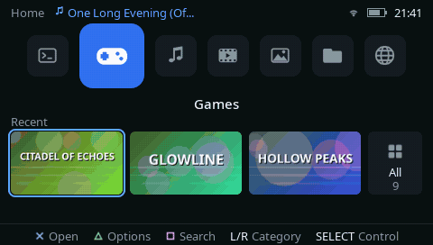
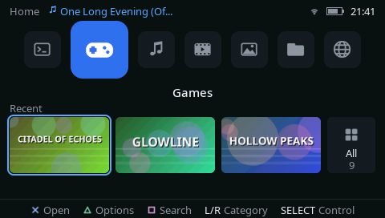
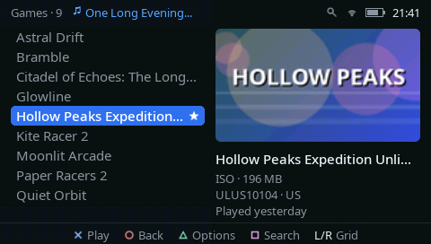
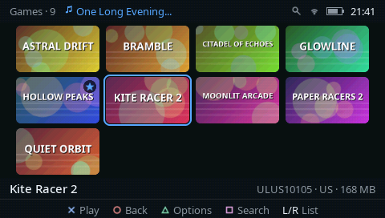
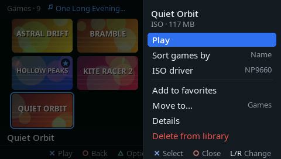
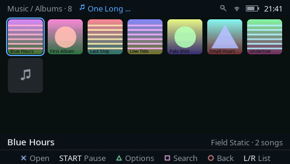
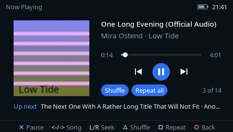
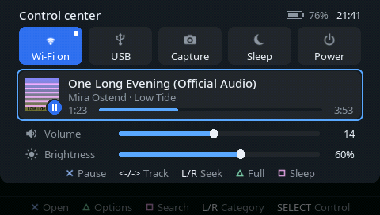
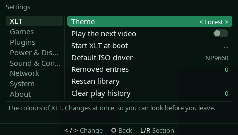
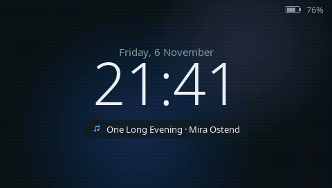

# XLT

A light, fast launcher for PSPs running the ARK custom firmware. It keeps the XMB's way of getting around
(L/R to switch categories, the d-pad for what's in them) in a flatter, quieter look, and puts your games,
music, videos, pictures and files one button away.

**The walk-through** (43 s, no sound):

https://github.com/user-attachments/assets/9d6550f0-c342-49eb-9dcf-0f1bcd3a4f90

> Everything in the screenshots and videos is made up, rendered on a PC from XLT's own drawing code:
> the games, songs, artists and artwork are invented, so none of it belongs to anyone.

## How it was made

XLT is a **vibe-coded** app. It was written with **Claude** (Anthropic's AI model) in
[Claude Code](https://claude.com/claude-code): the author described what XLT should do, chose between the
options Claude proposed, and tested every build on a real PSP, reporting back what worked and what didn't;
Claude wrote the code, the tools and the tests, and these docs. Much of it is checked automatically on a PC
(`make test`), and the hardware side was confirmed on a PSP-E1004 with ARK-5. Like any homebrew, it comes with
no warranty.

## What it does

- **One row for everything.** Homebrew, Games, Music, Video, Pictures, Files, Web and Settings, plus the UMD drive
  while a disc is in. Each card shows what you used last, and a game's animated icon or a video's preview plays
  once you rest on it.
- **Games.** ISO, CSO, ZSO and EBOOT games, PS1 classics and homebrew, as a list or a grid of icons. Per game:
  CPU speed, ISO driver, favourites, your own folders, details, and delete. Games start through ARK as they do
  from the XMB. Hold **L** while XLT starts to skip the library check (safe start).
- **Music.** MP3, AAC/M4A and FLAC by artist, album or playlist, with covers and lyrics. Shuffle, repeat, a sleep
  timer, and an even-volume mode that uses ReplayGain or Sound Check tags. It never makes anything louder, and
  it respects AVLS. Music keeps playing while you browse.
- **Video.** MP4 (H.264 and AAC) and PMF, with subtitles (`.srt` files or ones inside the MP4), several audio
  tracks, resume where you stopped, and the next episode in the folder.
- **Pictures.** JPEG, PNG, BMP and GIF, with zoom.
- **Files.** Copy, move, rename, delete and new folders, unpacking ZIP files (homebrew goes straight to
  `PSP/GAME`), save data backup and restore, and a reader for text and PDF files (Greek included).
- **Web.** A simple browser for text, links, forms and pictures over secure connections. It doesn't run
  JavaScript, and it needs a PSP-2000 or later.
- **Control center** (SELECT, anywhere). Wi-Fi status, USB mode, screenshot, sleep and power, the song playing,
  volume and brightness.
- **Screenshots, in games too.** L+R+START saves a screenshot as a PNG in `PICTURE/`, in XLT and in your games:
  XLT sets up a small plugin for ARK by itself the first time it starts (and turns off other screenshot plugins
  so two don't fire at once). In a game the screen edge flashes white when the shot is taken, and the game isn't
  paused by the START press. Not in the XMB.
- **Screen recording.** L+R+SELECT records XLT's screens to a video (a video playing included). This works only
  inside XLT, not in games or the XMB, and a recording stops when a game starts.
- **Settings.** XLT's own options, ARK's settings and plugins, and the PSP's system settings in one place.
  There are eight colour themes, which change at once, and interface sounds. About shows your model, firmware
  and Memory Stick space.
- **Screensaver.** A clock with the date and the song playing.

## Screenshots

| | |
|---|---|
|  |  |
| Home: the recent games on the Games card | The games list, with the focused game's icon |
|  |  |
| The same games as a grid | △: a game's options |
|  |  |
| Music by album, with covers | Now Playing |
|  |  |
| The control center (SELECT) | Settings, trying a theme |

## Getting started

You need a PSP with **ARK-4 or ARK-5** installed.

1. Copy the `XLT` folder to `PSP/GAME/` on the Memory Stick, so you have `PSP/GAME/XLT/EBOOT.PBP`.
2. Start **XLT** from the XMB's Game menu. The first start looks through the Memory Stick for your games, music,
   videos and pictures, which takes a few seconds; later starts are quicker.
3. To have your PSP start straight into XLT, turn on **Settings → XLT → Start XLT at boot**. XLT sets itself
   up as ARK's launcher and keeps ARK's own menu as `PSP/SAVEDATA/ARK_01234/VBOOT_ARKMENU.PBP`. Turning the
   setting off puts ARK's menu back. Exit to XMB from XLT's power menu takes you to the XMB as usual; the PSP
   then boots into the XMB until you open XLT again.

XLT looks for games in `ISO/` and `PSP/GAME/`, music in `MUSIC/`, videos in `VIDEO/` and pictures in `PICTURE/`.

## Controls

"Anywhere" means anywhere in XLT. Once a game or the XMB is running, the PSP's own buttons apply, except
L+R+START, which takes screenshots in games too.

| Where | Button | What it does |
|---|---|---|
| Anywhere | L / R | Switch category (on Home), or list ↔ grid in a list |
| Anywhere | ✕ / ○ | Open or start / back |
| Anywhere | △ | Options for what's focused |
| Anywhere | □ | Search |
| Anywhere | SELECT | Control center |
| Anywhere, and in games | L + R + START | Screenshot (saved in `PICTURE/`) |
| Anywhere | L + R + SELECT | Start or stop recording the screen (saved in `VIDEO/`) |
| Anywhere | HOME | Exit |
| Starting XLT | Hold L | Safe start: skip the library check |
| Lists | ↑ / ↓, ← / → | Move, a page at a time |
| Now Playing | ✕ / ← → / L R / △ / □ | Pause / previous, next / seek / shuffle / repeat |
| Video | ✕ / ← → / L R / △ / □ | Pause / 10 s back, ahead / 1 min / audio track / subtitles |
| Files | ✕ / ○ / △ / □ | Open / up / menu / mark |
| Reader | ✕ / L R / □ / △ | Next screen / page / find / menu |
| Web | ✕ / L R / □ / △ | Open / back, forward / address / menu |
| Screensaver | Any button | Wake |

## For developers

XLT is written in C with the PSPSDK. Build it with `make` (you need the pspdev toolchain and Python 3 with
Pillow); `make test` runs the host tests and renders the screens on the PC. How each part works, the firmware
calls it relies on, what was measured on hardware and how it is tested are in the
**[developer docs](docs/Home.md)**.

## Credits

XLT is free software under the **GPL-3.0** (see [LICENSE](LICENSE)).

Special thanks to [08Weber](https://github.com/08Weber) for [psp5](https://github.com/08Weber/psp5).

**Code from other projects**
- **[psp5](https://github.com/08Weber/psp5)** by 08Weber (GPL-3.0). XLT adapts several of its parts, and each of
  those files says so at the top:
  - the MP3 engine (`src/music.c`);
  - brightness, kernel calls and USB mode (`src/sysctl.c`);
  - the UMD drive watcher and boot paths (`src/umd.c`, `src/launch.c`);
  - the SETTINGS.TXT parser (`src/arkcfg.c`, `src/ark.c`);
  - the graphics set-up (`src/gfx.c`) and the exit and power callbacks (`src/main.c`);
  - the PMF video path (`src/video.c`);
  - the network start-up (`src/net.c`).

**Libraries**, linked from the pspdev toolchain, each under its own license:
- [libcurl](https://curl.se/) (curl license)
- [Mbed TLS](https://www.trustedfirmware.org/projects/mbed-tls/) (Apache-2.0)
- [libjpeg](https://ijg.org/) (IJG)
- [libpng](http://www.libpng.org/pub/png/libpng.html) (libpng)
- [giflib](https://giflib.sourceforge.net/) (MIT)
- [zlib](https://zlib.net/) (zlib)
- [LZ4](https://github.com/lz4/lz4) (BSD-2-Clause)
- [PSPSDK](https://github.com/pspdev/pspsdk) (BSD-style), with the SystemControl and kubridge stubs for ARK

**Built in as data**
- the [Noto Sans](https://fonts.google.com/noto) fonts (SIL Open Font License 1.1);
- Mozilla's CA certificate list (MPL-2.0), for secure web pages.

**References** (no code taken)
- [ARK](https://github.com/PSP-Archive/ARK-4)'s arkMenu: launching, plugins, SETTINGS.TXT, the UMD drive and USB.
- cooleyes' PMPlayer Advance and PMPlayer Ultraviolet: the video decoder interface and the weighted-prediction
  workaround.
- PPSSPP and psplibdoc: system call details.
- BetterBright: the brightness range.
- ARK's own preview video: the PMF layout.

The interface sounds are synthesised by XLT's build tools.

Thanks to the ARK team and the PSP homebrew community.

## Trademarks

PlayStation, PSP, PlayStation Portable, UMD, XMB and the PlayStation button symbols (△ ○ ✕ □) are
trademarks or registered trademarks of Sony Interactive Entertainment Inc. Memory Stick is a trademark of Sony
Group Corporation. ATRAC3plus is a trademark of Sony Group Corporation. Claude and Claude Code are trademarks of Anthropic. Other product and company names are
trademarks of their owners. The names are used here to say what XLT runs on and works with; the button
symbols appear in XLT's interface to show which of the PSP's buttons to press.

XLT is an independent, unofficial project. It is not affiliated with, endorsed, sponsored or approved by Sony
Interactive Entertainment, Sony Group Corporation or the ARK developers. It contains no Sony software or
firmware: it uses the system functions already on your PSP, through ARK. Use it at your own risk; the
software comes with no warranty (see the GPL-3.0).
